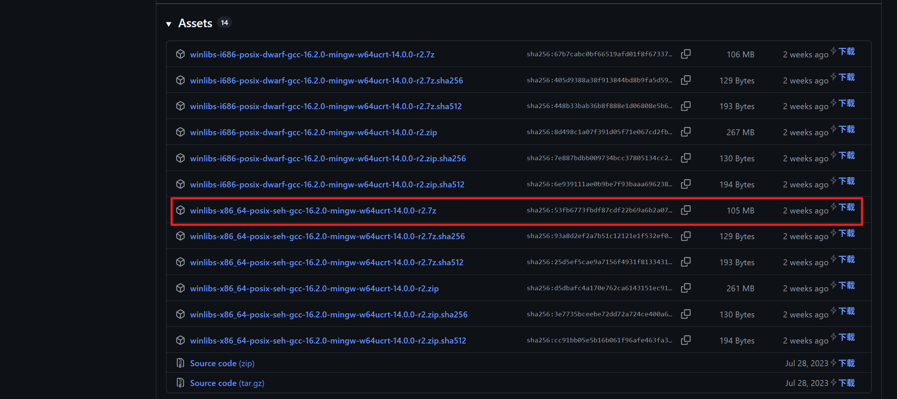
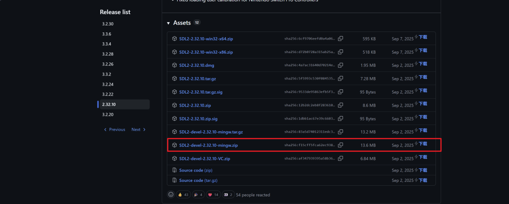
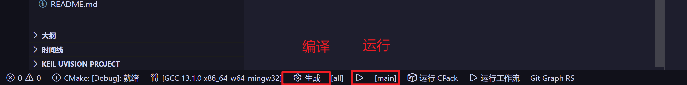

# LVGL v9.3 PC 模拟器环境搭建

## 一、全套软件准备（Windows 平台）

### 1. 工具清单

1. **VS Code**：代码编辑器
2. **MinGW-w64 GCC**：Windows 下的 gcc/g++（不是 arm-none-eabi）
3. **CMake**：工程构建工具
4. **Make**：构建后端（MinGW 自带 `mingw32-make`）
5. **SDL2**：提供窗口、鼠标、键盘驱动（模拟器必需）
6. **Git**：拉取工程与子仓库

### 2. 各工具安装配置

#### （1）MinGW-w64 GCC

下载地址：<https://github.com/brechtsanders/winlibs_mingw/releases>

1. 打开官方 GitHub 仓库下载最新版本的文件，选择 `mingw-w64-x86_64` 版本的 `.zip` 文件
2. 解压到自己想要的路径，本文为 `D:\software\tools_chain\mingw64`



#### （2）CMake 安装

下载地址：<https://cmake.org/download/>

1. 打开官网下载最新版本的二进制文件，选择 `windows-x86_64` 版本的 `.zip` 文件
2. 解压到自己想要的路径，本文为 `D:\software\tools_chain\CMake`

> MinGW-w64 发行包里通常自带一份 `cmake.exe`，装了它也可以直接用，不必单独下载。

#### （3）SDL2 开发包

下载地址：<https://github.com/libsdl-org/SDL/releases>

1. 打开官方 GitHub 仓库下载 `SDL2-devel-2.32.10-mingw.zip`（**mingw 版，不是 VC 版**）
2. 解压到 `D:\software\tools_chain\SDL2-2.32.10`



解压后关键目录（`x86_64-w64-mingw32` 是 64 位）：

#### （4）VSCode 插件安装（必须装）

打开 VSCode 扩展市场，搜索安装：

1. **C/C++**（微软官方，代码提示、调试）
2. **CMake Tools**（核心，管理 CMake 工程）

### 3. 环境变量

把上面几个工具的 `bin` 目录加入系统 `PATH`：

```
D:\software\tools_chain\mingw64\bin
D:\software\tools_chain\CMake\bin
D:\software\tools_chain\SDL2-2.32.10\x86_64-w64-mingw32\bin
```

添加完成后，在 cmd 中输入下面指令验证版本：

```bash
gcc --version
cmake --version
mingw32-make --version
```

本文验证环境

- MinGW-w64 GCC：**13.1.0**
- CMake：**4.4.3**（MinGW 自带）/ 3.31.0-rc3（单独安装的那份）
- SDL2：**2.32.10**
- LVGL：**v9.3.0**

版本接近即可正常跟随本文操作。

## 二、工程搭建过程

### 1. 克隆主工程并切换分支

```bash
git clone https://github.com/lvgl/lv_port_pc_eclipse.git
cd lv_port_pc_eclipse
git checkout release/v9.3
```

### 2. 去掉原仓库的 git 记录

```bash
rm -rf .git
git init
git add .
git commit -m "init: lv_port_pc_eclipse release/v9.3"
```

### 3. 添加 lvgl 子仓库并切换标签

不用 `--recursive`（那样拉的是子模块默认分支），手动添加后锁定标签：

```bash
git submodule add https://github.com/lvgl/lvgl.git lvgl
cd lvgl
git checkout v9.3.0
cd ..
git add .gitmodules lvgl
git commit -m "submodule: lock lvgl to v9.3.0"
```

验证：

```bash
git submodule status      # c033a98... lvgl (v9.3.0)
```

目录改名为 `lvgl_simulator_v9.3`（可选）。

## 三、适配 MinGW：改 CMakeLists.txt

官方脚本面向 Linux/macOS，在 MinGW 下必改 4 处。

### 1. 指定 SDL2 位置

在 `find_package(SDL2 REQUIRED SDL2)` 之前加，否则可能找到 MinGW 自带的旧版 SDL2：

```cmake
if(NOT SDL2_DIR)
    if(DEFINED ENV{SDL2_DIR})
        set(SDL2_DIR "$ENV{SDL2_DIR}")
    elseif(EXISTS "D:/software/tools_chain/SDL2-2.32.10/x86_64-w64-mingw32/lib/cmake/SDL2")
        set(SDL2_DIR "D:/software/tools_chain/SDL2-2.32.10/x86_64-w64-mingw32/lib/cmake/SDL2")
    endif()
endif()
find_package(SDL2 REQUIRED SDL2)
```

### 2. 去掉 SDL2main（解决 `undefined reference to SDL_main`）

MinGW 下 `SDL2_LIBRARIES` 含 `SDL2::SDL2main`，它只提供 `WinMain` 并要求入口叫 `SDL_main`（靠 `SDL.h` 里的 `#define main SDL_main`），而 `main.c` 没引 `SDL.h`：

```cmake
set(MAIN_SDL2_LIBS ${SDL2_LIBRARIES})
if(MINGW)
    list(REMOVE_ITEM MAIN_SDL2_LIBS SDL2::SDL2main)
endif()
target_link_libraries(main lvgl lvgl::examples lvgl::demos lvgl::thorvg ${MAIN_SDL2_LIBS} m pthread)
```

### 3. 关掉 sanitizer（解决 `cannot find -lasan/-lubsan`）

MinGW 不提供 ASan/UBSan 运行库，原脚本 Debug 下这两行要包一层判断：

```cmake
if(NOT WIN32 AND NOT MINGW AND NOT MSVC)
    target_compile_options(main PRIVATE -fsanitize=address,leak,undefined)
    target_link_options(main PRIVATE -fsanitize=address,leak,undefined)
endif()
```

### 4. 构建后自动拷贝 SDL2.dll

```cmake
if(WIN32 AND TARGET SDL2::SDL2)
    add_custom_command(TARGET main POST_BUILD
        COMMAND ${CMAKE_COMMAND} -E copy_if_different
                $<TARGET_FILE:SDL2::SDL2> $<TARGET_FILE_DIR:main>
        COMMENT "Copying SDL2.dll to the executable directory")
endif()
```

## 四、构建
