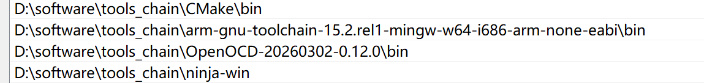
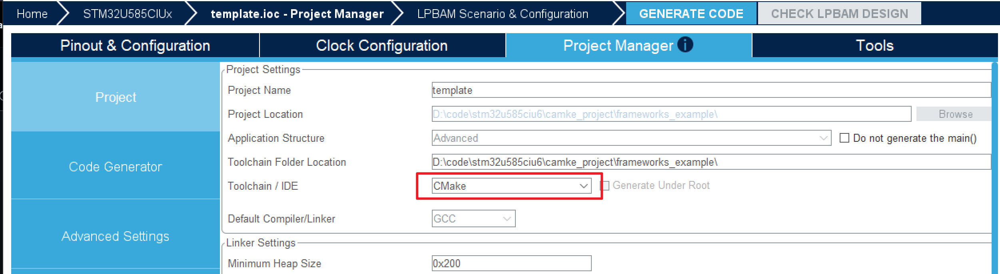
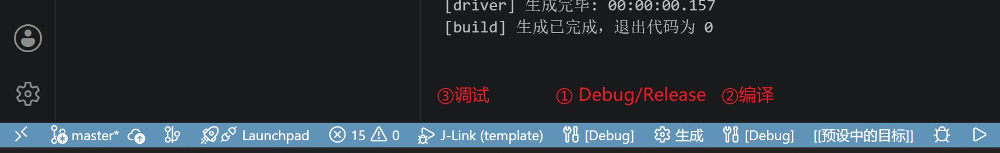

# VSCode + CMake + GCC ARM 搭建 STM32 开发环境

## 一、全套软件准备（Windows 平台）

### 1. 工具清单

1. **VS Code**：代码编辑器
2. **ARM GCC 交叉编译器**：`arm-none-eabi-gcc`（STM32 专用，不是普通 gcc）
3. **CMake**：工程构建工具
4. **Ninja（推荐）/ Make**：构建后端，编译更快
5. **STM32CubeMX**：生成底层初始化代码、芯片外设配置
6. **OpenOCD**：下载调试固件（ST-Link / JLink）
7. **Git**（可选）

### 2. 各工具安装配置

#### （1）ARM GCC 编译器

下载地址：<https://developer.arm.com/downloads/-/arm-gnu-toolchain-downloads>

1. 打开官方网站下载最新版本的 arm-none-eabi-gcc 文件，选择 mingw-w64-x86_64 版本的 `.zip` 文件
2. 解压到自己想要的路径

#### （2）CMake 安装

下载地址：<https://cmake.org/download/>

1. 打开官网下载最新版本的二进制文件，选择 windows-x86_64 版本的 `.zip` 文件
2. 解压到自己想要的路径

#### （3）Ninja（提速）

下载地址：<https://github.com/ninja-build/ninja/releases>

1. 打开 Ninja 的官方 GitHub 仓库下载最新版本的文件，选择 win 版本的 `.zip` 文件
2. 解压到自己想要的路径

#### （4）OpenOCD（下载调试必备）

下载地址：<https://gnutoolchains.com/arm-eabi/openocd/>

1. 打开官方网站下载最新版本的 OpenOCD 文件，选择最新版本的 `.7z` 文件
2. 解压到自己想要的路径

#### （5）VSCode 插件安装（必须装）

打开 VSCode 扩展市场，搜索安装：

1. **C/C++**（微软官方，代码提示、调试）
2. **CMake Tools**（核心，管理 CMake 工程）
3. **Cortex-Debug**（ARM 单片机调试，替代 GDB 插件）

### 3. 环境变量

把上面几个工具的 `bin` 目录加入系统 `PATH`：



添加完成后，在 cmd 中输入下面指令验证版本：

```bash
arm-none-eabi-gcc -v
cmake --version
ninja --version
OpenOCD --version
```

本文验证环境
- arm-none-eabi-gcc：**15.2.1**（Arm GNU Toolchain 15.2.Rel1）
- CMake：**3.31.0-rc3**
- Ninja：**1.13.2**
- OpenOCD：**0.12.0**

版本接近即可正常跟随本文操作。如果是 CubeMX 早期版本生成的旧工程，建议把 GCC 降到 10.3 或 13.2 —— 新版编译器（15.x）对旧 HAL / FreeRTOS 代码可能产生新的告警甚至链接脚本兼容问题。

## 二、CubeMX 新建 CMake 工程

生成代码的页面有个选项选择 ToolChain/IDE，找到 CMake 并选择，然后点击生成代码。




## 三、VSCode 编译烧录调试

### 编译烧录

1. VSCode 打开项目文件夹
2. 打开新的工程会让选择 CMake 目标，调试阶段就选择 Debug，发布阶段就选择 Release
3. 点击左下角的**生成**，执行 CMake 项目构建
4. 点击调试按钮



在 `.vscode` 路径下创建 `launch.json`，放下面内容，然后调试按钮就会变成 JLink：

```json
{
    "version": "0.2.0",
    "configurations": [
        {
            "name": "J-Link",
            "cwd": "${workspaceFolder}",
            /* 生成的烧录文件路径：适配 F411 项目路径 */
            "executable": "./build/Debug/${workspaceFolderBasename}.elf",
            "request": "launch",
            "type": "cortex-debug",
            /* 调试服务器：类型 */
            "servertype": "jlink",
            /* 使用的芯片：STM32F411CE (J-Link 识别不带 U6 后缀) */
            "device": "STM32F411CE",
            /* 调试开始运行到 main 函数 */
            "runToEntryPoint": "main",
            "showDevDebugOutput": "none",
            "interface": "swd",
            /* 寄存器配置文件：STM32F411 的 SVD 文件 */
            "svdFile": "${workspaceFolder}/STM32F411.svd",
            /* JLINK-GDB 服务器路径：请确认你的安装盘符是否为 D 盘 */
            "serverpath": "D:/software/programme/J-linkV898/JLink_V898/JLinkGDBServerCL.exe",
            /* 此项目是用来 JLink-RTT 打印调试 log 用的 */
            "rttConfig": {
                "enabled": true,
                "controlBlockAddress": "auto",
                "clearSearch": false,
                "polling_interval": 20,
                "decoders": [
                    {
                        "label": "RTT Console",
                        "port": 0,
                        "type": "console"
                    }
                ]
            },
            /* 此项目是用来打开实时监控变量的 */
            "liveWatch": {
                "enabled": true,
                "samplesPerSecond": 5
            }
        }
    ]
}
```

## 四、参考

- [STM32+VSCode+CMake 开发环境搭建](https://b23.tv/Zh5jbK6)
