# 移植 LVGL 8.3

## 一、移植 LVGL

### 1. 前期准备

- LCD 显示驱动程序
- 触摸驱动程序
- LVGL 8.3 版本库文件

### 2. 裁剪 LVGL

首先前往 LVGL 官网下载源码：<https://codeload.github.com/lvgl/lvgl/zip/refs/tags/v8.3.10>

解压后里头文件众多：源代码、帮助文档、官方示例等等。不用发晕，真正需要用到的仅仅是 **3 个文件夹 + 2 个 h 文件**。

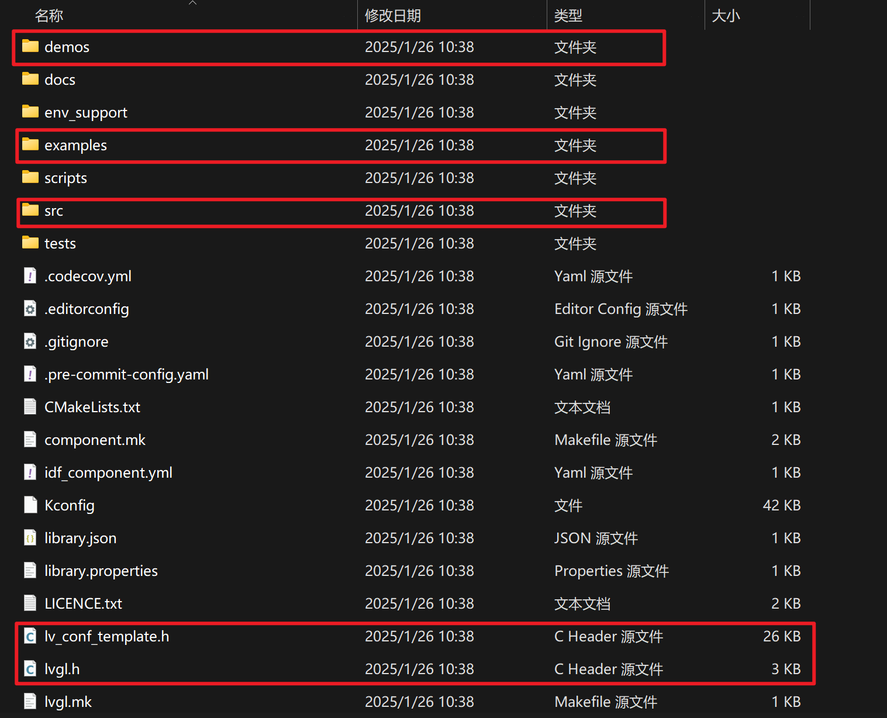

同时把 `lv_conf_template.h` 改名为 `lv_conf.h`：

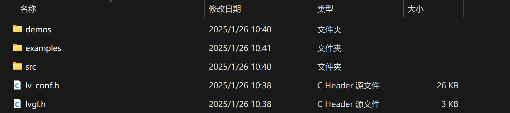

`examples` 文件夹只保留 `porting`：

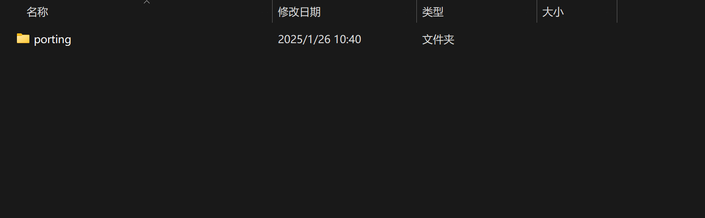

到此 LVGL 就裁剪完成了。

### 3. 添加分组

网上好些教程在 Keil 工程目录下新建 `Middlewares` 文件夹，在里面再新建 LVGL 文件夹。如果你用的是标准库工程，或者自己手撸建立的 HAL 库工程，都可以那样操作。

但如果使用 CubeMX、CubeIDE 生成的工程，**不要**用 `Middlewares` 作文件夹名称 —— 它刚好是 CubeMX 可能生成的中间件目录（存放 FreeRTOS、FatFS 等支持文件）。如果你没有使能这些中间件，CubeMX 重新生成工程时该文件夹会被认为不需要而删除掉。

添加四个分组：

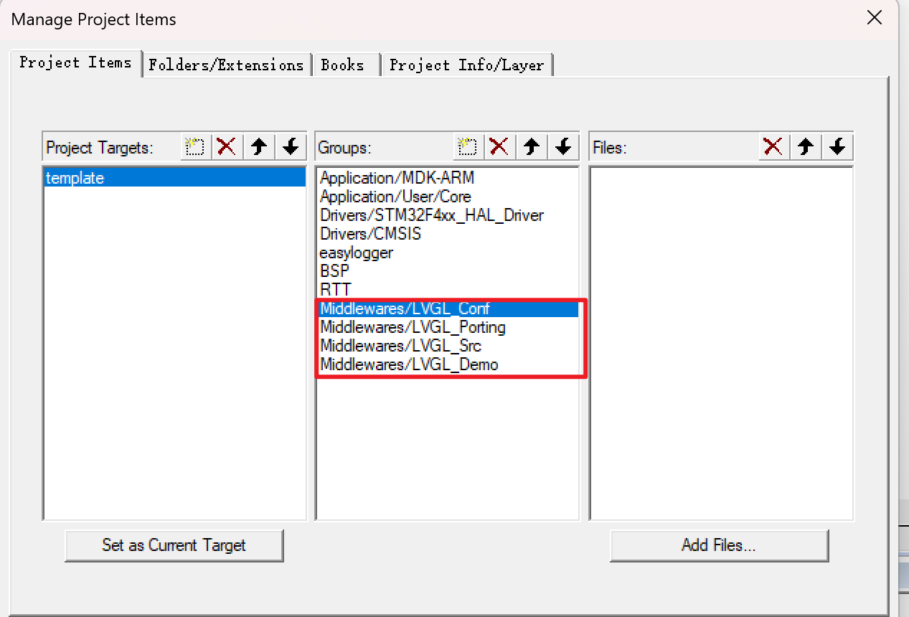

- 网上好些教程会新建近 10 个 Group 分开存放各个子功能文件，其实 4 个就够了，简单直观。

- 这里用下划线作名称分界线。尝试过使用 `/`，感觉没下划线直观，你可以用自己喜欢的风格。

- **LVGL_Conf**

  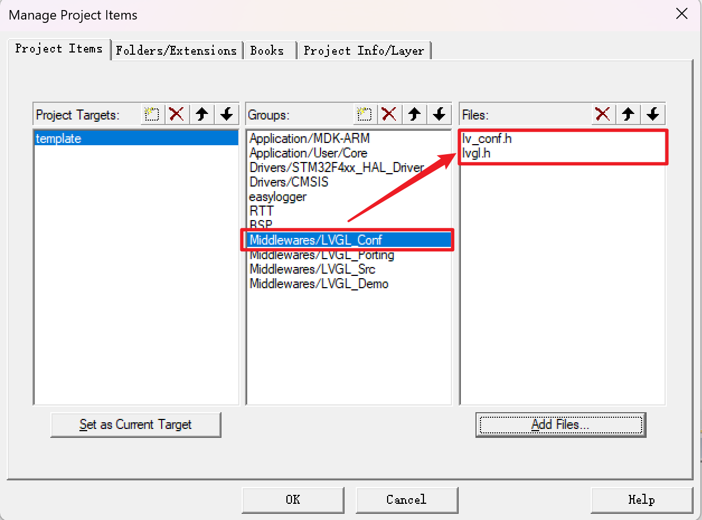

- **LVGL_porting**：主要是输入设备和显示设备。

  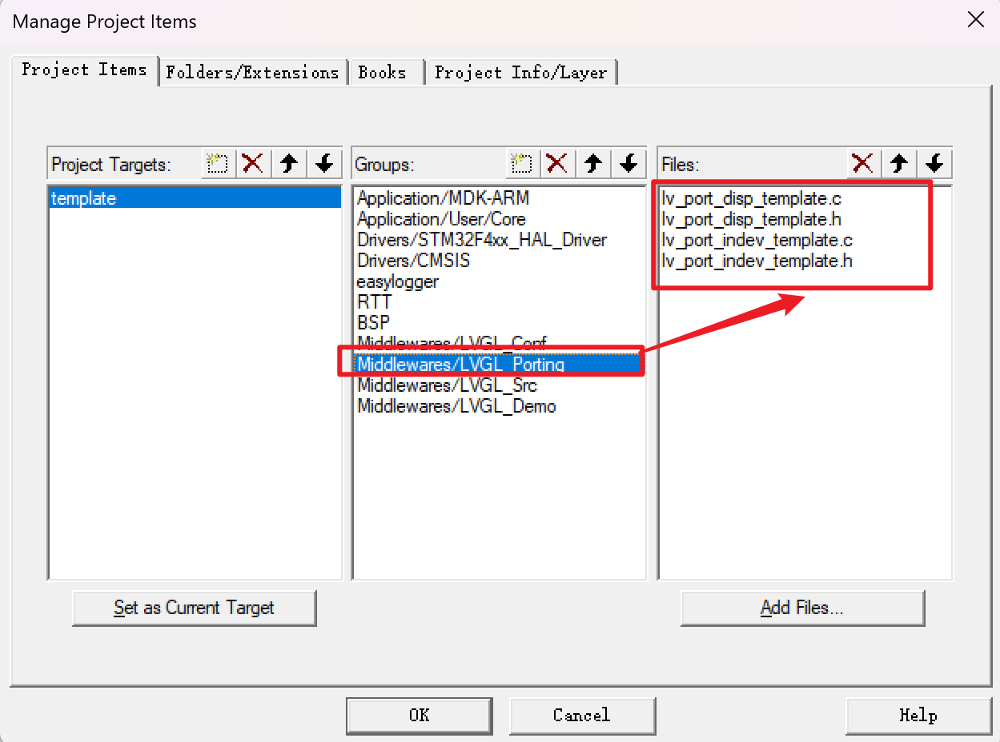

- 添加 `src` 文件夹里面所有 `.c` 文件，包含子文件夹。文件有点多，耐心一点添加。

  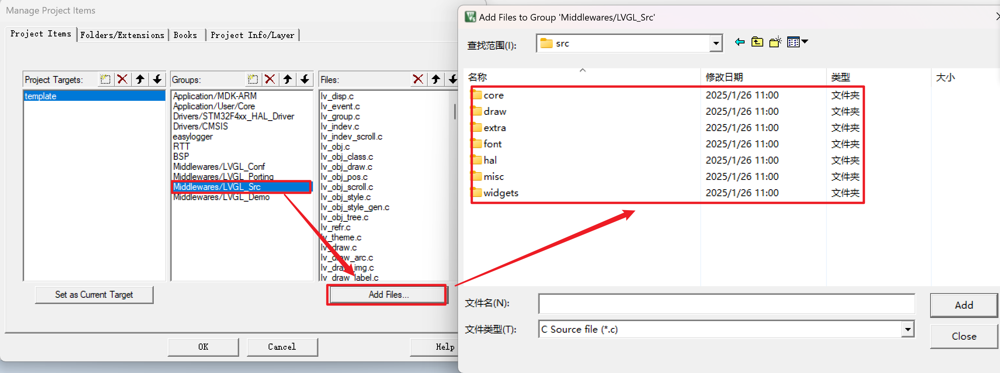

### 4. 添加头文件路径

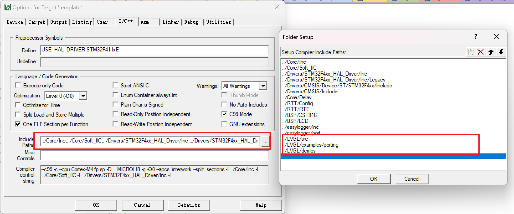

### 5. 添加显示

修改 `lv_port_disp.h`：

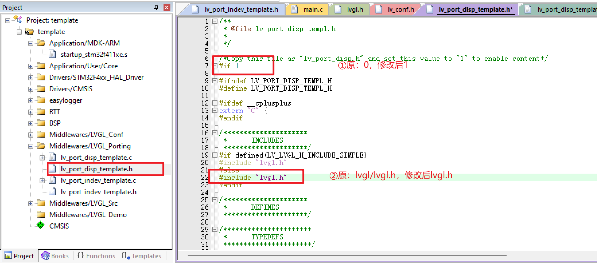

修改 `lv_port_disp.c`：

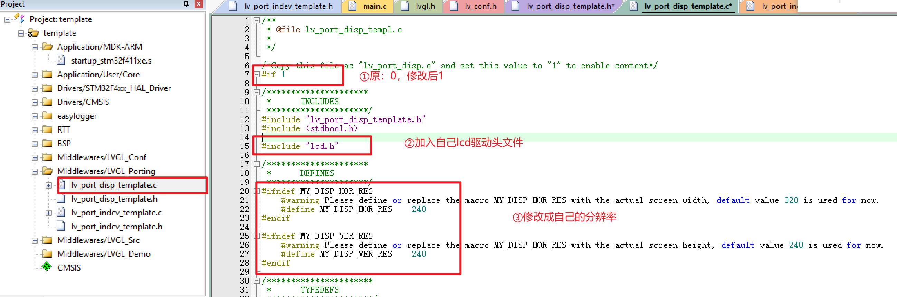

向下滚动找到缓冲区：

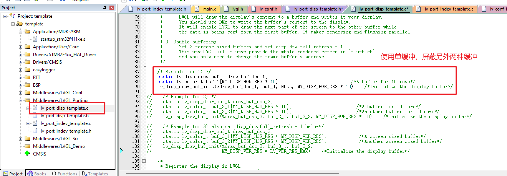

修改屏幕刷新：

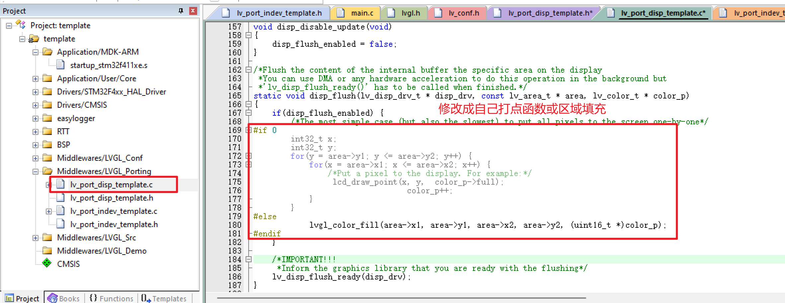

::: tip 进阶技巧：提高刷屏效率
一般地，画点函数的底层操作是：发送 X 坐标指令、X 值、Y 坐标指令、Y 值、颜色值。

假如要刷 320x240 的整屏，至少传输 14 万次指令、14 万次坐标值、7 万次颜色值，相当耗时。

要是你的 LCD 驱动文件中有区域填充颜色的函数，就能大量减少指令、坐标值的发送次数：

`lvgl_color_fill(area->x1, area->y1, area->x2, area->y2, (uint16_t *)color_p);`

如果没有区域填充函数，不用强求，直接使用画点函数吧 —— 先完成，再完善。
:::

### 6. 添加触摸

修改 `lv_port_indev.h`：

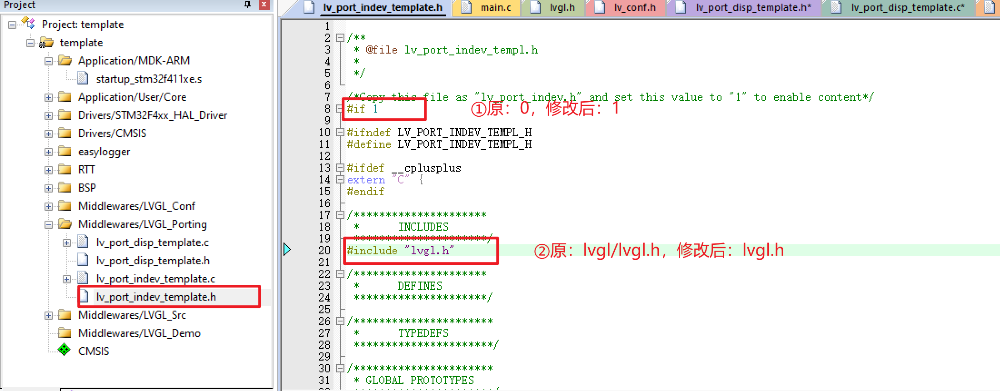

修改 `lv_port_indev.c`：

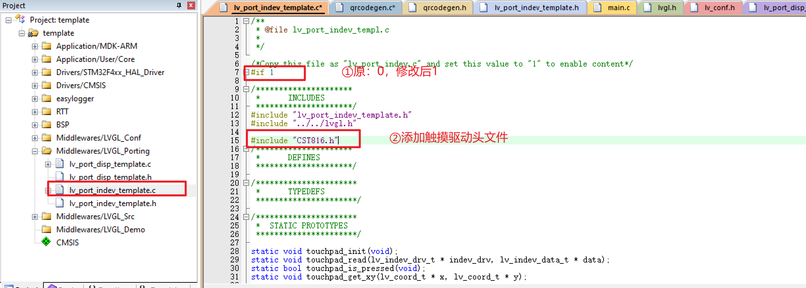

保留触摸屏输入的任务注册，其它 4 种输入任务的注册注释掉：

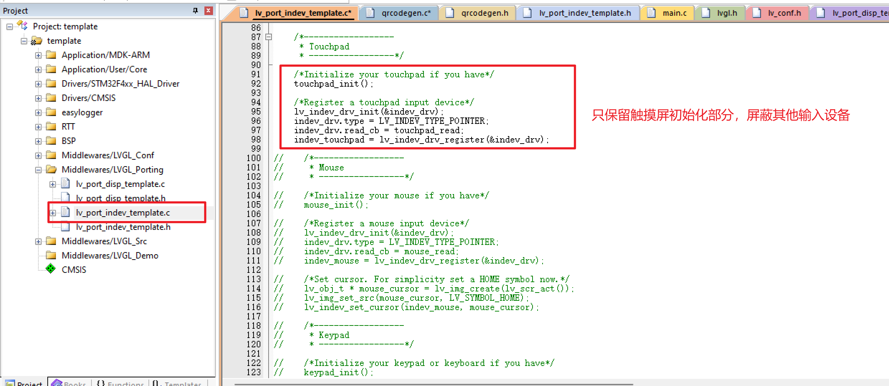

添加自己的触摸函数：

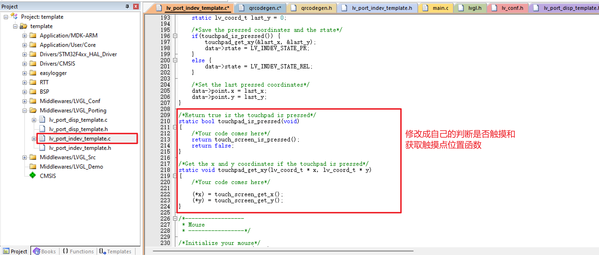

### 7. 添加 LVGL 心跳与任务刷新

#### 裸机

定时器 1ms 中断中添加心跳 `lv_tick_inc(1)`：

```c
void HAL_TIM_PeriodElapsedCallback(TIM_HandleTypeDef *htim)
{
    if (htim->Instance == TIM3)
    {
        lv_tick_inc(1);
    }
}
```

主循环添加 `lv_timer_handler()`，5ms 任务刷新：

```c
/* Infinite loop */
/* USER CODE BEGIN WHILE */
while (1)
{
    lv_timer_handler();
    HAL_Delay(5);
    // lcd_clear_test();
    /* USER CODE END WHILE */

    /* USER CODE BEGIN 3 */
}
/* USER CODE END 3 */
```

#### 带操作系统

使用了 FreeRTOS 可以不用手动提供心跳，使能 `#define LV_TICK_CUSTOM 1`：

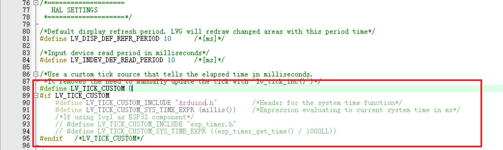

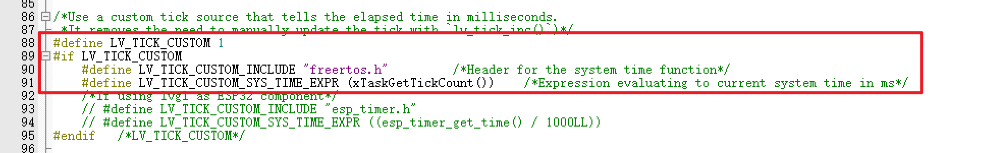

```c
#define LV_TICK_CUSTOM 1
#if LV_TICK_CUSTOM
    #define LV_TICK_CUSTOM_INCLUDE "freertos.h"      /* Header for the system time function */
    #define LV_TICK_CUSTOM_SYS_TIME_EXPR (xTaskGetTickCount())  /* Expression evaluating to current system time in ms */
    /* If using lvgl as ESP32 component */
    // #define LV_TICK_CUSTOM_INCLUDE "esp_timer.h"
    // #define LV_TICK_CUSTOM_SYS_TIME_EXPR ((esp_timer_get_time() / 1000LL))
#endif   /* LV_TICK_CUSTOM */
```

### 8. 运行官方 Demo

在 `main.c` 中包含下面头文件：

```c
#include "lvgl.h"
#include "lv_port_disp_template.h"
#include "lv_port_indev_template.h"
#include "lv_demo_widgets.h"
```

在 main 函数内、`while` 循环之前调用 LCD 初始化函数、触摸屏初始化函数。下面是我所用的 LCD 驱动函数：

```c
touch_init();
lcd_set_dir(LCD_PORTAIT);
lcd_set_color(RGB565_RED, RGB565_BLACK);
lcd_init();
lcd_full(RGB565_GRAY);
```

在硬件初始化代码之后进行 LVGL 的初始化：

```c
lv_init();
lv_port_disp_init();
lv_port_indev_init();
```

调用官方 widgets 初始化：

```c
lv_demo_widgets();
```

添加 `demos` 文件夹中所需的所有 `.c` 文件，以 widgets 为例，添加 widgets 文件夹中所有 `.c` 文件：

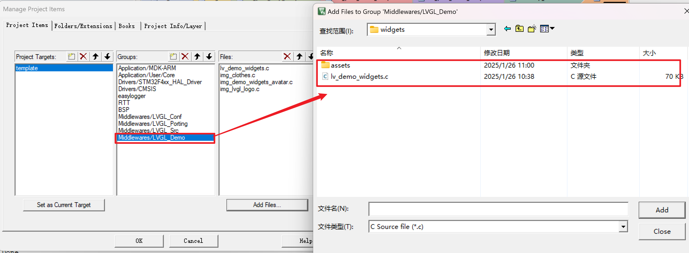

使用哪个 demo，就在 `lv_conf.h` 中使能相对应的宏定义：

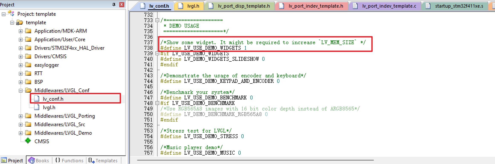

添加头文件路径：

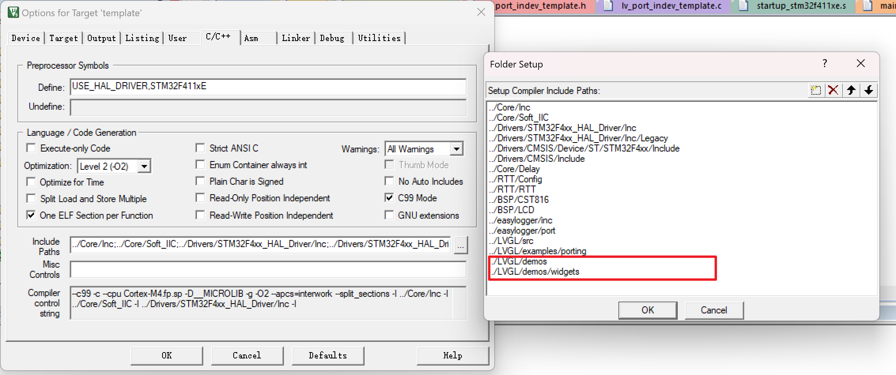

## 二、优化帧率

### 1. 修改 LVGL 屏幕刷新帧率

LVGL 有一个帧率刷新周期的宏定义，在 `lv_conf.h` 第 80 行。LVGL 会定时去刷屏幕，该宏定义限定了刷屏帧率的上限，默认满帧 33 帧。

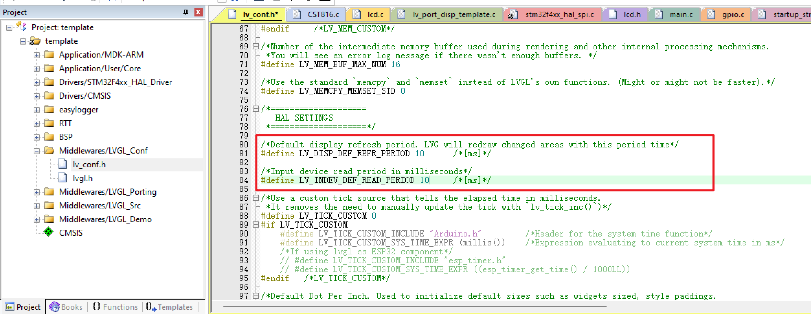

这里我们直接改成 10ms 刷新一次，满帧 100 帧，顺手再把输入设备读取周期也改成 10ms。

### 2. 修改刷屏方法

在 `lv_port_disp.c` 文件中：

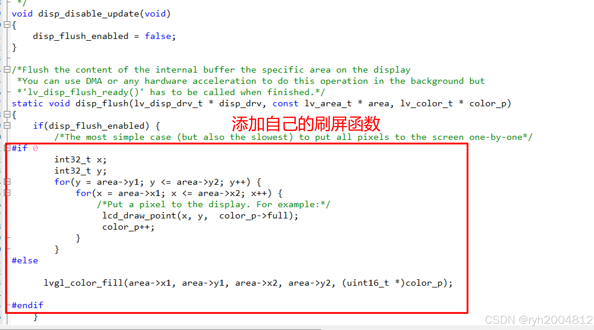

不要使用画点函数，例如以下写法效率很低：

```c
for (y = area->y1; y <= area->y2; y++)
{
    for (x = area->x1; x <= area->x2; x++)
    {
        /* Put a pixel to the display. For example: */
        lcd_draw_point(x, y, color_p->full);
        color_p++;
    }
}
```

修改成区域颜色填充：

```c
lvgl_color_fill(area->x1, area->y1, area->x2, area->y2, (uint16_t *)color_p);
```

### 3. 使用硬件 SPI 或 DMA

这里我设置了一个宏定义，在 DMA 和硬件 SPI 两种方式之间来回切换，实测通过 DMA 转运帧率有明显提升。

DMA 一次最多能发送 65535 个数据，所以设置缓冲时缓冲大小不要超过 65535。我配置的是 8 位的，也就是一次最多能发送 65535 个字节；一个像素 2 个字节，即一次最多能发送 32767 个像素。

**标准库实现：**

```c
void lvgl_color_fill(uint16 xsta, uint16 ysta, uint16 xend, uint16 yend, uint16 *color)
{
#if USE_DMA
    uint16 height, width;
    uint32 byte_sum;        // 总字节数

    width  = xend - xsta + 1;    // 计算填充的宽度
    height = yend - ysta + 1;    // 计算填充的高度

    byte_sum = width * height * 2; // 每个像素两个字节

    lcd_set_region(xsta, ysta, xend, yend); // 设置 LCD 的填充区域
    LCD_CS(0);
    LCD_DC(1);                              // 写数据

    // 循环发送数据，直到填充完整个区域
    while (byte_sum > 0)
    {
        uint32 bytes_to_send = (byte_sum > LCD_BUF_SIZE) ? LCD_BUF_SIZE : byte_sum;

        // 填充 DMA 缓冲区
        for (uint32 i = 0; i < bytes_to_send; i += 2)
        {
            uint8 high_byte = *color >> 8;   // 高 8 位颜色
            uint8 low_byte  = *color & 0xFF; // 低 8 位颜色

            lcd_buf[i]     = high_byte;
            lcd_buf[i + 1] = low_byte;
            color++;
        }

        // 开始 DMA 传输
        dma_transfer(bytes_to_send);

        // 更新剩余字节数
        byte_sum -= bytes_to_send;
    }
    LCD_CS(1);
#else
    uint16 height, width;
    uint16 i = 0, j = 0;

    width  = xend - xsta + 1;  /* 得到填充的宽度 */
    height = yend - ysta + 1;  /* 高度 */

    uint16 color_buffer[width];

    lcd_set_region(xsta, ysta, xend, yend); // 设置光标位置
    for (i = 0; i < height; i++)
    {
        for (j = 0; j < width; j++)
        {
            color_buffer[j] = *color;
            color++;
        }
        // 一行一行填充，效率更高
        lcd_write_16bit_data_array(color_buffer, width);
    }
#endif
}
```

**HAL 库实现：**

```c
void lvgl_color_fill(
        uint16_t xsta,
        uint16_t ysta,
        uint16_t xend,
        uint16_t yend,
        uint16_t *color)
{
#if USE_DMA && (!SOFT_SPI)
    uint16_t height, width;
    uint32_t byte_sum; // Total byte count

    width  = xend - xsta + 1;  // Calculate width for the fill area
    height = yend - ysta + 1;  // Calculate height for the fill area

    byte_sum = width * height * 2; // Bytes for each pixel

    lcd_set_region(xsta, ysta, xend, yend); // Set fill area for the LCD

    LCD_CS(0);
    LCD_DC(1); // Write data

    // Loop to send data until the area is filled
    while (byte_sum > 0)
    {
        uint32_t bytes_to_send = (byte_sum > LCD_BUF_SIZE) ? LCD_BUF_SIZE : byte_sum;

        // Fill the DMA buffer
        for (uint32_t i = 0; i < bytes_to_send; i += 2)
        {
            uint8_t high_byte = *color >> 8;  // High byte of color
            uint8_t low_byte  = *color & 0xFF; // Low byte of color

            lcd_buf[i]     = high_byte;
            lcd_buf[i + 1] = low_byte;
            color++;
        }

        // Start DMA transmission
        // dma_transfer(bytes_to_send);
        g_dma_transfer_complete_flag = 0;
        HAL_SPI_Transmit_DMA(&hspi1, lcd_buf, bytes_to_send);
        /* 使用 volatile 修饰 g_dma_transfer_complete_flag，避免被编译器优化 */
        while (!g_dma_transfer_complete_flag);

        // Update remaining byte count
        byte_sum -= bytes_to_send;
    }
    LCD_CS(1);
#else
    uint16_t height, width;
    uint16_t i = 0, j = 0;

    width  = xend - xsta + 1;  /* Calculate fill width */
    height = yend - ysta + 1;  /* Calculate fill height */

    uint16_t color_buffer[width];

    lcd_set_region(xsta, ysta, xend, yend); // Set cursor position

    for (i = 0; i < height; i++)
    {
        for (j = 0; j < width; j++)
        {
            color_buffer[j] = *color; // Set color from the array
            color++;                  // Move to the next color
        }
        lcd_write_16bit_data_array(color_buffer, width); // Fill row
    }
#endif
}
```

### 4. 修改代码优化等级

这个对帧率的影响还是挺大的，这里我使用的是 Level - 2，下面的 `Optimize for Time` 也勾上。

Level - 3 我自己用的时候不如 Level - 2，具体原因还不知道。

### 5. 修改单缓冲刷新区域

默认刷新区域为 10 行，修改为屏幕的八分之一：

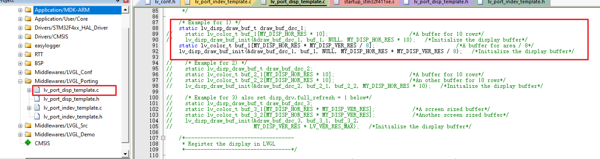

### 6. 单缓冲改为双缓冲

LVGL 双缓冲的切换是 LVGL 自动进行的，我们不用去处理指针切换和数据交替填充的操作，只需要在刷新函数里获取对应的颜色数据地址 —— 那就是当前要发送的数据地址，LVGL 已经帮我们切换好了双缓冲的指针。

在 `disp_flush` 函数里我们直接填充数据，接口不变。

## 三、LVGL 一些可选配置

### 1. 在右下角显示 CPU 使用率、FPS 帧数

`lv_conf.h` 中第 282 行找到 `LV_USE_PERF_MONITOR`，原值 `0`，修改为 `1`。

### 2. 在左下角显示 LVGL 的内存使用率

`lv_conf.h` 中第 289 行找到 `LV_USE_MEM_MONITOR`，原值 `0`，修改为 `1`。

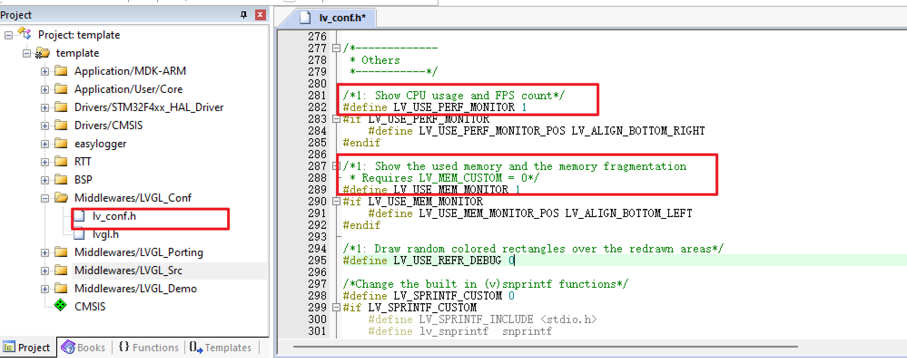

### 3. 黑色主题

`lv_conf.h` 中第 579 行找到 `LV_THEME_DEFAULT_DARK`，原值 `0`，修改为 `1`。

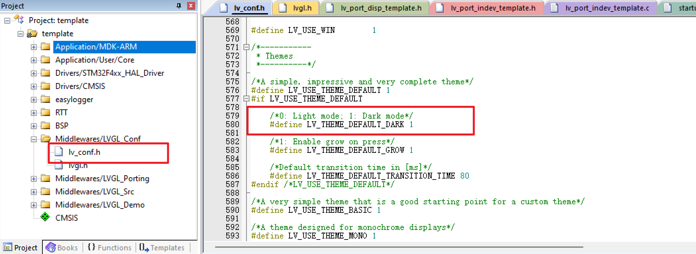

## 四、遇到的问题

### 1. 运行官方 Demo `lv_demo_widgets` 卡死，显示停止在初始化结束一刻

解决办法：堆栈溢出，增大 Stack Size。

启动文件代码默认栈的最小空间为 `0x400`，测试改为 `0x800` 后可以正常运行 demo，具体需要改多大还需实际使用后自行拿捏。

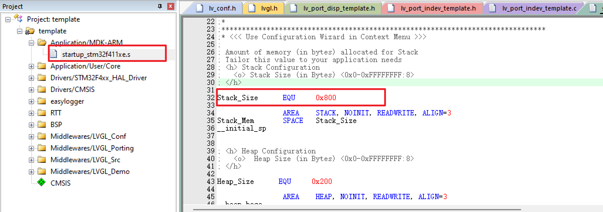

### 2. 编译报错

编译后如果出现 **Undefined symbol `__aeabi_assert`** 这个错误：

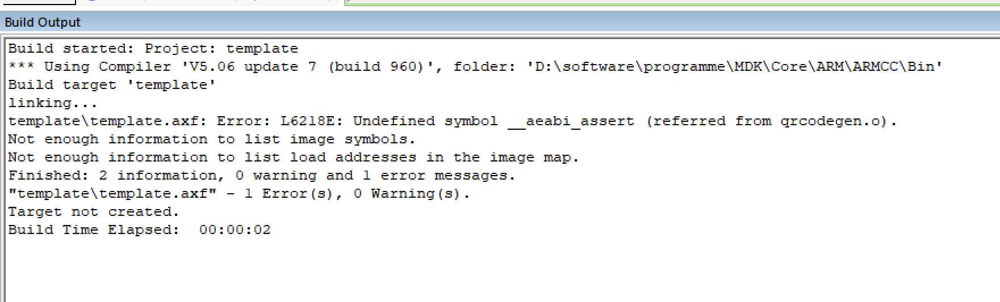

解决方法：

1. 勾选 Use MicroLIB：

   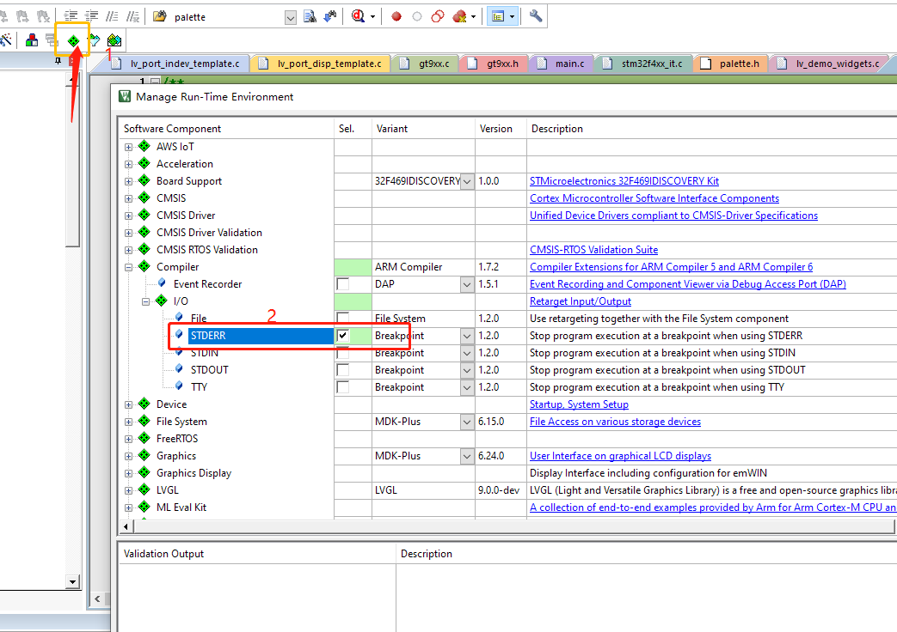

2. 或者去掉下图这个对号（不建议，printf 重定向需要这个）：

   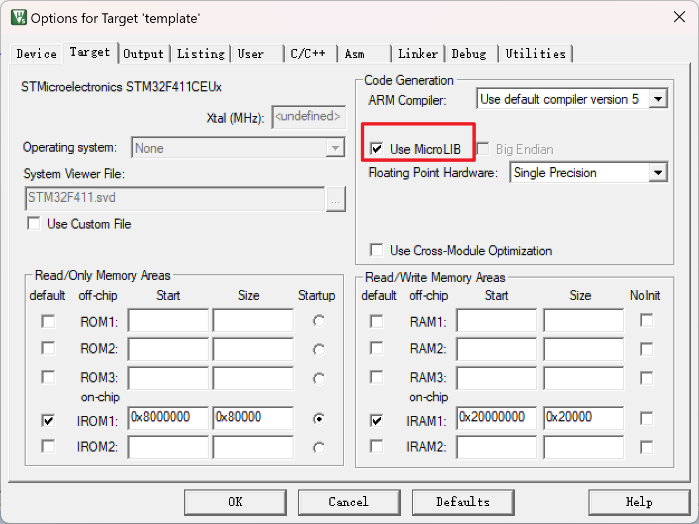

## 五、移植 Gui_Guider 代码到 STM32

1. 在工程中创建一个 UI 文件夹存放 ui 界面

   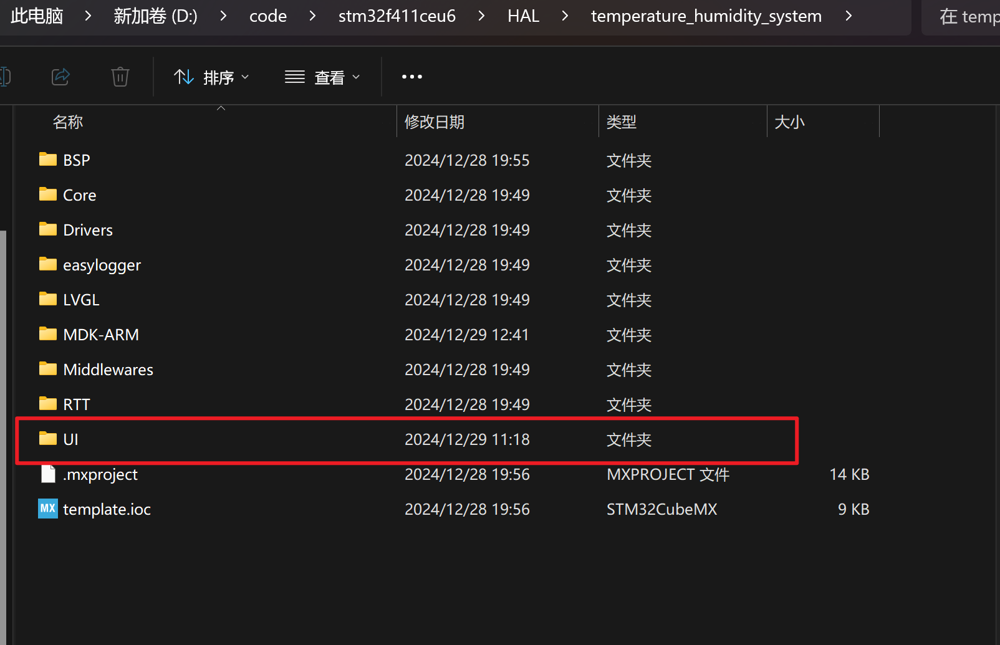

2. 将 Gui_Guider 中两个文件添加到自己的工程里

   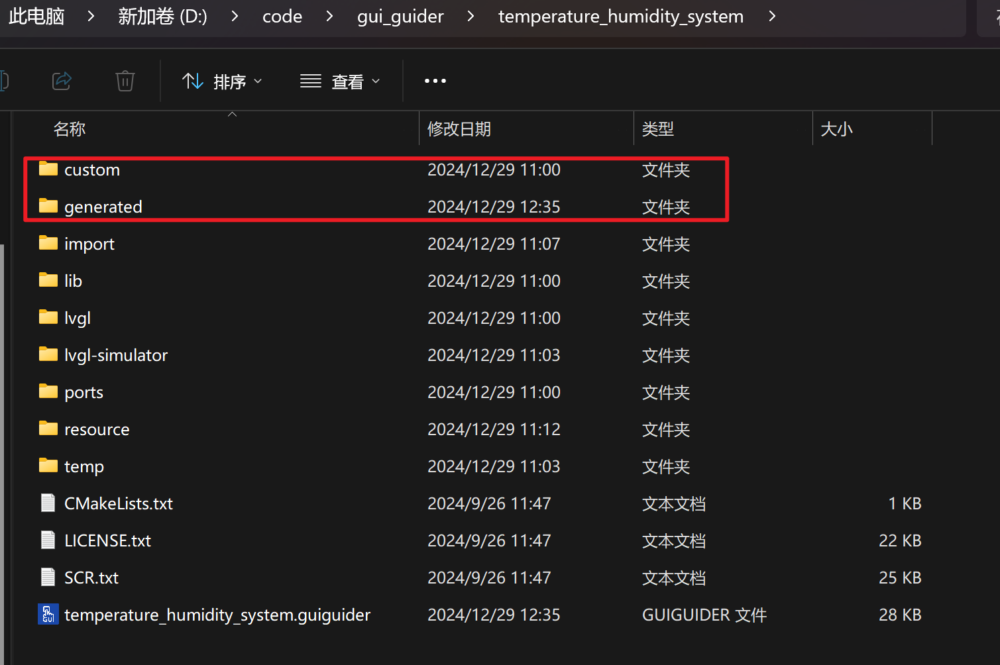

   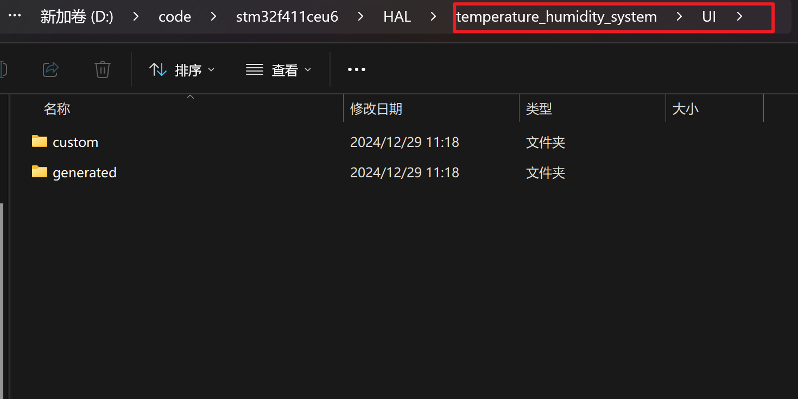

3. 工程中添加分组

   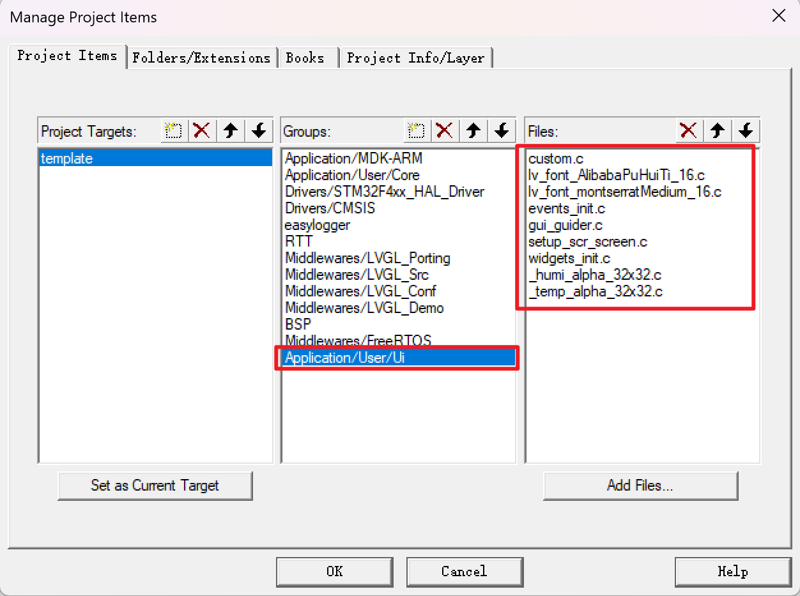

4. 添加 `custom` 和 `generated` 文件夹以及子文件夹中所有 `.c` 文件

   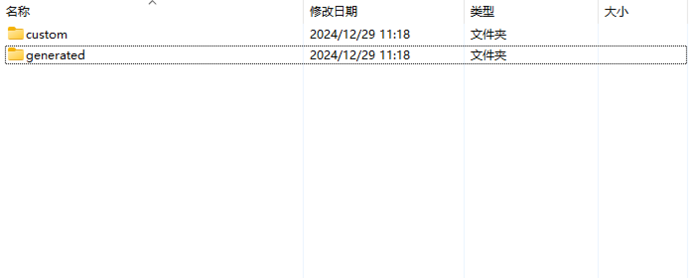

5. 添加头文件路径

   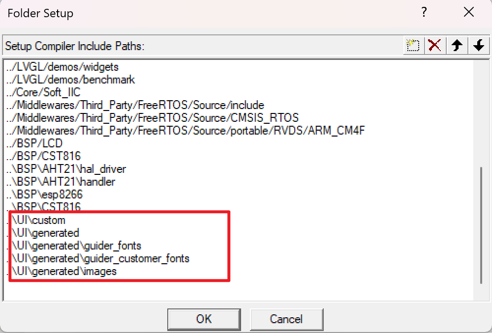

6. 主函数添加头文件

   ```c
   #include "gui_guider.h"
   #include "events_init.h"
   ```

7. 创建全局变量

   ```c
   lv_ui guider_ui;
   ```

8. 初始化 ui 界面和事件

   ```c
   setup_ui(&guider_ui);
   events_init(&guider_ui);
   ```

## 六、参考

- [快速入门 LVGL -- 1、STM32 工程移植 LVGL](https://blog.csdn.net/qq_49053936/article/details/136696700)
- [如何一步一步地优化 LVGL 的丝滑度](https://blog.csdn.net/qq_28576837/article/details/136357727)
